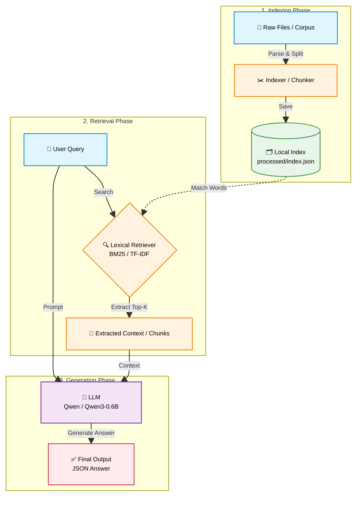

*This activity has been created as part of the 42 curriculum by abani-am*

---
## System Architecture

## Description

**RAG (Retrieval-Augmented Generation) lets a language model answer from an external source instead of relying only on its training data. This project indexes the vLLM repository, retrieves the most relevant snippets for a question (BM25), and feeds them to Qwen3-0.6B to generate a grounded answer.**

**How Does RAG work?**
*(Example: Customer Support)*
1. **Data Collection**
2. **Data chunking**
3. **Document embeddings & load data into vector database**
4. **Handling user queries:** Once the query is converted into an embedding, the system compares the query embedding with the document embeddings. It identifies and retrieves chunks whose embeddings are most similar to the query embedding, using measures such as cosine similarity

5. **Generating responses with an LLM:** The retrieved text chunks, along with the initial user query, are fed into a language model.

## Resources
- [NOTED] - (https://youtu.be/LIFyBPDkluI?si=-wSRP-grv_I1HQBc)
- [NOTED] - (https://youtu.be/sNLbKNMa6zI?si=QJkowz_fW-QmaxDO)
- [NOTED **Theoretical**] (https://youtu.be/rcovF6S1oFI?si=epbMj3qHqUZ0Bx4J)
- [NOTED **TF-IDF**] - (https://youtu.be/8Q0IdDI7yeE?si=EFxhLXiEeCWRTTqV)
- [fifth lesson **BM25**] - (https://youtu.be/YL-3G5-xVYU?si=Oxl_KMnYuDAdMoOU)

- [Full course on RAG](https://youtube.com/playlist?list=PLvLvlVqNQGHCUR2p0b8a0QpVjDUg50wQj&si=3JDbYtnrhWURKFTE)
