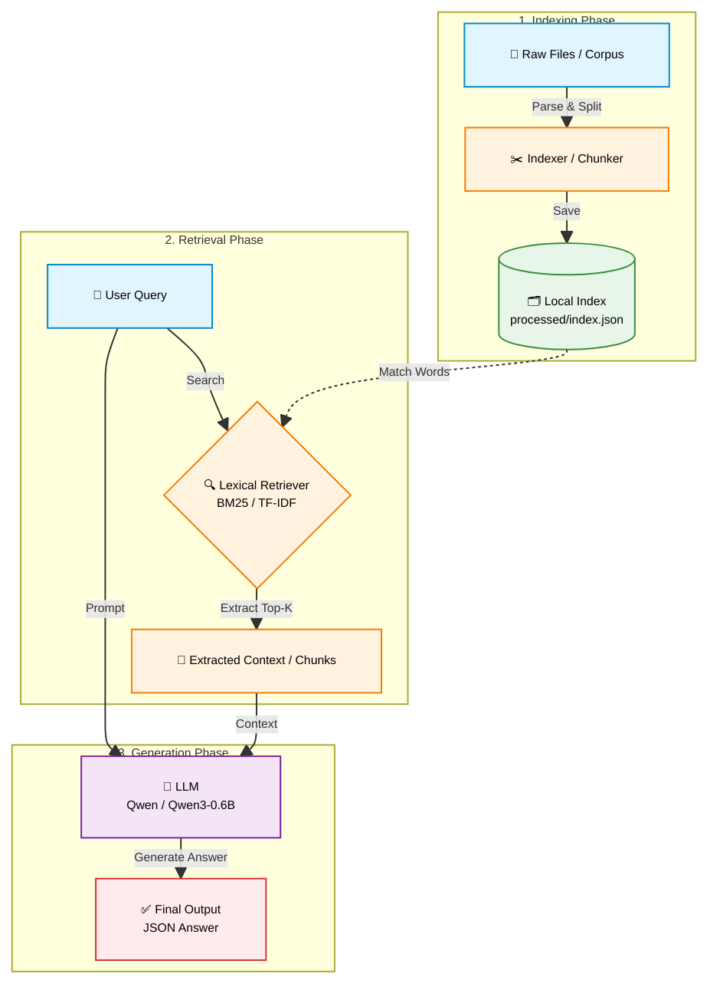

*This activity has been created as part of the 42 curriculum by abani-am*

---
## System Architecture


Each stage exchanges Pydantic-validated schemas (`src/models.py`): the **Indexer** persists chunk metadata and exact character spans, the **BM25 Retriever** ranks top-$k$ source locations, and the **Generator** reads those spans from `data/raw/` to build a grounded prompt for `Qwen/Qwen3-0.6B`.
---

## Description

**RAG (Retrieval-Augmented Generation) lets a language model answer from an external source instead of relying only on its training data. This project indexes the vLLM repository, retrieves the most relevant snippets for a question (BM25), and feeds them to Qwen3-0.6B to generate a grounded answer.**

**How Does RAG work?**
*(Example: Customer Support)*
1. **Data Collection**
2. **Data chunking**
3. **Document embeddings & load data into vector database**
4. **Handling user queries:** Once the query is converted into an embedding, the system compares the query embedding with the document embeddings. It identifies and retrieves chunks whose embeddings are most similar to the query embedding, using measures such as cosine similarity

5. **Generating responses with an LLM:** The retrieved text chunks, along with the initial user query, are fed into a language model.

---
## Instructions

### Prerequisites & Setup
Dependencies and caches are managed with `uv` and routed to `/goinfre` via the `Makefile` to respect 42 disk quotas.

```bash
# Install dependencies
make install

# Run static checks (flake8 & mypy)
make lint

# Run CLI help / default entrypoint
make run

# Debug with pdb
make debug

# Remove temporary caches
make clean
```

---

## Chunking Strategy
Two dedicated splitters segment the corpus under the strict `--max_chunk_size` limit (default `2000` characters) while preserving exact `(first_character_index, last_character_index)` offsets and verbatim `file_path` strings:
- **Python code chunking (`.py`):** Splits along structural code boundaries (classes, functions, and logical blocks) so identifiers and signatures stay intact.
- **Markdown / text chunking (`.md`, `.txt`):** Splits along headings and paragraphs to keep semantic sections coherent.

---
## Retrieval Method
- **Algorithm:** First-principles **BM25** lexical retrieval over tokenized chunks persisted in `data/processed/`.
- **Why BM25:** Unlike raw TF-IDF, BM25 applies term-frequency saturation ($k_1$) and document-length normalization ($b$), preventing long files or repeated keywords from dominating rankings while matching exact code identifiers and technical terms in milliseconds.

---


## Performance Analysis
- **recall@k**: What fraction of the needed evidence did we find in the top-k (a match counts when the `file_path` is exact and character span $IoU > 0.05$).

| Metric | Target | Measured *(update after moulinette run)* |
| :--- | :--- | :--- |
| **Docs Recall@5** | $\ge 80\%$ | `TBD` |
| **Code Recall@5** | $\ge 50\%$ | `TBD` |
| **Indexing Time** | $\le 5$ min | `< 5s` (20,334 chunks) |
| **Retrieval Throughput** | $\le 90$s / 200 queries | `TBD` |

---
## Design Decisions
- **First-principles pipeline:** Avoided high-level RAG wrappers (e.g., LangChain) to keep indexing, BM25 scoring, and context assembly transparent, fast, and easy to debug.
- **Strict Pydantic schemas:** All stage outputs (`StudentSearchResults`, `StudentSearchResultsAndAnswer`) are validated to guarantee Moulinette compatibility.
- **Local `Qwen/Qwen3-0.6B` via Hugging Face `transformers`:** Loaded directly with `enable_thinking=False` and `do_sample=False` (greedy decoding) for deterministic, grounded answers without requiring an external server.
- **CLI with Python Fire & `tqdm`:** Exposes configurable input/output paths (zero hard-coded paths) with progress bars and graceful handling of edge cases (`k=0`, empty queries, missing files).

---
## Challenges Faced
- **42 Home Disk Quota:** Deep-learning dependencies (`torch`, `transformers`) and model weights exceed home directory limits. **Solution:** Exported `UV_PROJECT_ENVIRONMENT`, `UV_CACHE_DIR`, and `HF_HOME` to `/goinfre/$(USER)/` in the `Makefile`.
- **Qwen3 `<think>` Overhead:** `Qwen/Qwen3-0.6B` emits internal reasoning tokens by default, exhausting `max_new_tokens`. **Solution:** Passed `enable_thinking=False` to `apply_chat_template`.
- **Strict Moulinette Validation:** Any chunk $> 2000$ characters or mismatched `file_path` prefix invalidates the entire output. **Solution:** Enforced hard span bounds during chunking and preserved relative `data/raw/vllm-0.10.1/...` paths verbatim.

---

## Example Usage

```bash
# 1. Index the corpus
uv run python -m src index --max_chunk_size 2000

# 2. Single-query search
uv run python -m src search "How to configure the OpenAI server?" --k 5

# 3. Batch dataset search
uv run python -m src search_dataset \
  --dataset_path data/datasets/UnansweredQuestions/dataset_docs_public.json \
  --k 10 \
  --save_directory data/output/search_results/UnansweredQuestions

# 4. Local Recall@k evaluation
uv run python -m src evaluate \
  --student_search_results_path data/output/search_results/UnansweredQuestions/dataset_docs_public.json \
  --dataset_path data/datasets/AnsweredQuestions/dataset_docs_public.json

# 5. Single-query answer generation
uv run python -m src answer "How to configure the OpenAI server?" --k 5

# 6. Batch dataset answer generation
uv run python -m src answer_dataset \
  --student_search_results_path data/output/search_results/UnansweredQuestions/dataset_docs_public.json \
  --save_directory data/output/search_results_and_answer/UnansweredQuestions
```
---

## Resources
- [RAG & RAG Evaluation from Scratch — Taha Hussein](https://youtu.be/C1GCj27z3eE?si=tUnVjFefe-eUi5v0) — Theoretical walkthrough of the RAG pipeline, chunking strategies, and retrieval/generation evaluation metrics (`Recall@k`, `Precision@k`, faithfulness, and relevance).
- [BM25 Algorithm: Overcoming the Limitations of TF-IDF — MLWorks](https://youtu.be/YL-3G5-xVYU?si=Oxl_KMnYuDAdMoOU) — Detailed breakdown of BM25 scoring, term saturation ($k_1$), and document-length normalization ($b$).
- [mini-RAG | From notebooks to the PRODUCTION — Abu Bakr Soliman](https://youtube.com/playlist?list=PLvLvlVqNQGHCUR2p0b8a0QpVjDUg50wQj&si=3JDbYtnrhWURKFTE) — End-to-end practical RAG engineering course covering architecture and production design.

### AI Usage
AI tools were used as a technical collaborator for:
- Reviewing Pydantic data models, `Makefile` `/goinfre` environment routing, and `flake8`/`mypy` compliance.
- Designing the local `Qwen/Qwen3-0.6B` Hugging Face inference wrapper (`src/generator.py`) and structuring CLI edge-case handling.
- Refining documentation wording and verifying README completeness against subject requirements.