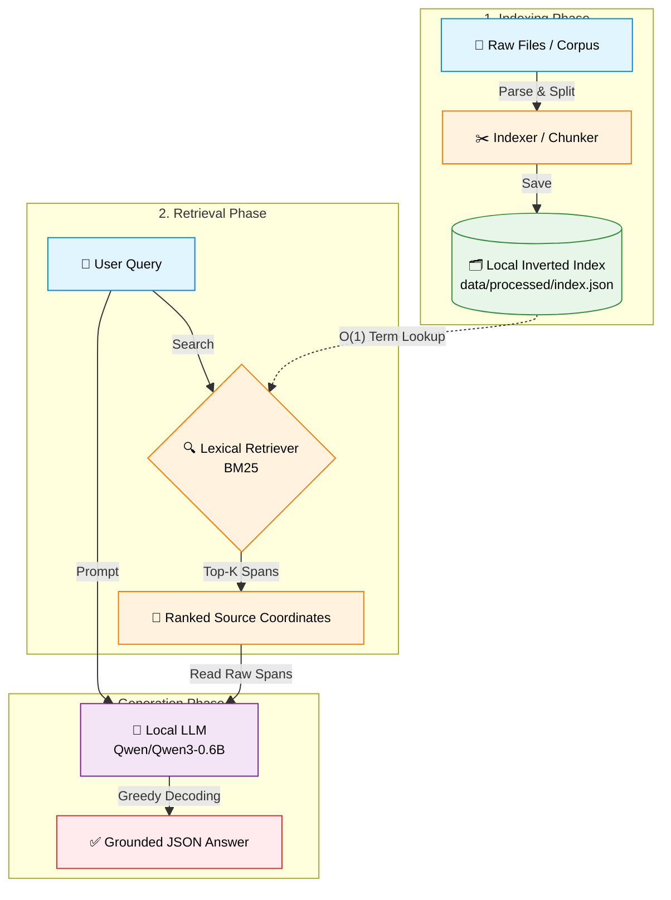

# RAG Against the Machine

**A first-principles Lexical RAG pipeline built from scratch in Python — indexing the vLLM codebase with an inverted-index BM25 retriever and generating grounded answers locally via `Qwen/Qwen3-0.6B`.**


---

## Overview

Retrieval-Augmented Generation (RAG) enables language models to answer technical questions using external sources rather than relying solely on parametric memory.

Instead of relying on high-level frameworks (like LangChain) or heavy vector databases, this project implements every stage from scratch—structural chunking, inverted-index construction, BM25 ranking, local batched LLM inference, and `Recall@k` evaluation—optimized for fast CPU execution and high precision on technical documentation and source code (`vLLM v0.10.1`).

---

## Performance Benchmarks

Evaluation uses **Recall@k**—measuring the fraction of queries where the exact reference `file_path` is retrieved within the top-*k* results with a character-span Intersection over Union (`IoU > 0.05`).

| Metric | Target | Measured |
| :--- | :--- | :--- |
| **Docs Recall@5** | ≥ 80% | **`83.0%`** |
| **Code Recall@5** | ≥ 50% | **`77.8%`** |
| **Indexing Time** | ≤ 5 min | **`4.41s`** (13,973 chunks) |
| **Retrieval Throughput** | ≤ 90s / 200 queries | **`1.68s`** / 199 queries |

---
## System Architecture



Each stage communicates through strict Pydantic-validated schemas (`src/models.py`):
1. **Ingestion:** Walks `data/raw/` to collect `.py`, `.md`, and `.txt` files deterministically.
2. **Chunking:** Segments files along structural boundaries ($\le 2000$ chars) while storing exact `(first_character_index, last_character_index)` offsets instead of duplicating raw text.
3. **Indexing:** Tokenizes chunks (including `camelCase`, `snake_case`, and file path tokens) into a compact **BM25 inverted index** (`data/processed/index.json`).
4. **Retrieval:** Performs $O(1)$ in-memory term lookups and ranks matching chunks using BM25 in milliseconds.
5. **Generation:** Reads the retrieved character spans from disk and feeds them with the query into **`Qwen/Qwen3-0.6B`** to produce concise, grounded JSON answers.

---

## Technical Design

### Chunking Strategy
Two dedicated splitters enforce the `--max_chunk_size` limit (default `2000` characters) using a 4-tier fallback (structural boundary $\rightarrow$ newline $\rightarrow$ space $\rightarrow$ hard cut) while preserving exact character offsets and verbatim relative paths:
- **Python (`.py`):** Splits along `class`, `def`, and `async def` boundaries to keep signatures and logic intact.
- **Markdown & Text (`.md`, `.txt`):** Splits along headings (`#`) and blank-line paragraphs to preserve semantic sections.

### Retrieval Method (BM25 + Inverted Index)
- **Why Lexical over Vector DBs:** Technical queries on a codebase rely heavily on exact identifiers, flags, and function names. BM25 with code-aware tokenization delivers higher exact-match precision and sub-2-second CPU throughput without the latency and memory overhead of a second neural embedding model.
- **Scoring:** Applies term-frequency saturation ($k_1 = 1.5$), document-length normalization ($b = 0.75$), and Inverse Document Frequency (IDF) to prevent long files or common tokens from dominating rankings.

### Key Architectural Decisions
- **Zero Framework Lock-in:** Built from scratch without LangChain to keep tokenization, scoring, and prompt assembly transparent and easy to debug.
- **Strict Data Contracts:** Every pipeline output (`StudentSearchResults`, `StudentSearchResultsAndAnswer`) is validated via Pydantic.
- **Optimized Local Inference:** Loads `Qwen/Qwen3-0.6B` directly through Hugging Face `transformers` with lazy imports (keeping search commands instant), `enable_thinking=False`, length-sorted batching with left padding, and greedy decoding (`do_sample=False`).
- **Resilient CLI:** Powered by Python Fire and `tqdm` with zero hard-coded paths and clean handling of edge cases (`k=0`, empty/gibberish queries, and missing files).

---

## Engineering Challenges & Solutions

- **Constrained Disk Quotas:** Heavy dependencies (`torch`, `transformers`) and model weights can exceed tight home-directory limits. **Solution:** Routed `UV_PROJECT_ENVIRONMENT`, `UV_CACHE_DIR`, and `HF_HOME` to temporary high-capacity storage (`/goinfre`) via the `Makefile`.
- **`Qwen3` Reasoning Overhead:** `Qwen/Qwen3-0.6B` emits `<think>` tokens by default, exhausting `max_new_tokens` before producing the final answer. **Solution:** Passed `enable_thinking=False` to `apply_chat_template`.
- **Index Size & Load Speed:** Pretty-printing nested `[doc_id, tf]` postings inflates `index.json` into millions of lines. **Solution:** Implemented compact per-entry serialization to keep the index small, fast to load, and human-readable.
- **Strict Span Integrity:** Any chunk exceeding `2000` characters or mismatched path prefix breaks downstream evaluation. **Solution:** Enforced hard character-span bounds during chunking and preserved verbatim relative paths end-to-end.

---

## Getting Started

### Prerequisites & Setup
Dependencies and caches are managed via `uv` and automated through the `Makefile`.

```bash
# Install dependencies
make install

# Run static checks (flake8 & mypy)
make lint

# Run CLI help / default entrypoint
make run

# Run full CLI verification suite
make test

# Run Recall@k retrieval evaluation
make eval

# Debug with pdb / remove temporary caches
make debug
make clean
```

### Example Usage

```bash
# 1. Index the corpus
uv run python -m src index --max_chunk_size 2000

# 2. Single-query search
uv run python -m src search "How to configure the OpenAI server?" --k 5

# 3. Batch dataset search
uv run python -m src search_dataset \
  --dataset_path data/datasets/UnansweredQuestions/dataset_docs_public.json \
  --k 10 \
  --save_directory data/output/search_results/UnansweredQuestions

# 4. Single-query answer generation
uv run python -m src answer "How to configure the OpenAI server?" --k 5

# 5. Batch dataset answer generation
uv run python -m src answer_dataset \
  --student_search_results_path data/output/search_results/UnansweredQuestions/dataset_docs_public.json \
  --save_directory data/output/search_results_and_answer/UnansweredQuestions

# 6. Local Recall@k evaluation
uv run python -m src evaluate \
  --student_search_results_path data/output/search_results/UnansweredQuestions/dataset_docs_public.json \
  --dataset_path data/datasets/AnsweredQuestions/dataset_docs_public.json
```

---

## References
- [RAG & RAG Evaluation from Scratch — Taha Hussein](https://youtu.be/C1GCj27z3eE?si=tUnVjFefe-eUi5v0) — RAG pipeline theory, chunking strategies, and retrieval/generation evaluation metrics.
- [BM25 Algorithm: Overcoming the Limitations of TF-IDF — MLWorks](https://youtu.be/YL-3G5-xVYU?si=Oxl_KMnYuDAdMoOU) — Breakdown of BM25 scoring, term saturation ($k_1$), and length normalization ($b$).
- [mini-RAG | From Notebooks to Production — Abu Bakr Soliman](https://youtube.com/playlist?list=PLvLvlVqNQGHCUR2p0b8a0QpVjDUg50wQj&si=3JDbYtnrhWURKFTE) — End-to-end RAG architecture and production engineering.
- [RAG Techniques](https://youtu.be/LIFyBPDkluI?si=vSB5oTFcRc4tm-bc) — Practical RAG patterns and retrieval refinements.
- Official Documentation: [Pydantic](https://docs.pydantic.dev/) · [Python Fire](https://github.com/google/python-fire) · [tqdm](https://tqdm.github.io/)

---

## Author

**Ahmad Bani Amer**  
GitHub: [@ahmadalameri-0](https://github.com/ahmadalameri-0)

linkedin: [Ahmad Bani Amer](https://www.linkedin.com/feed/foryou/)